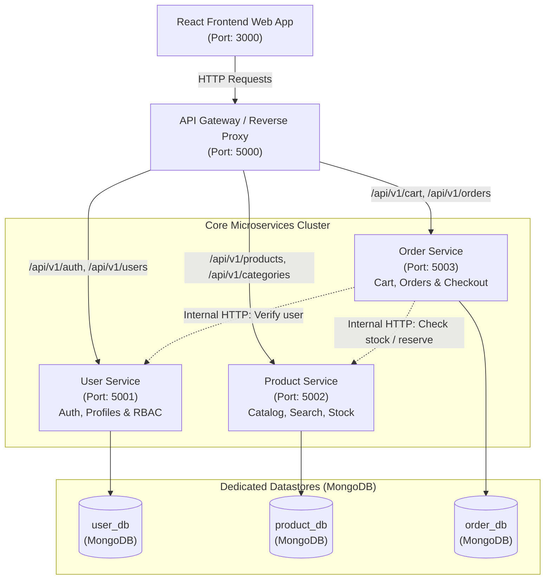

# Microservices Architecture Specification

## 1. Architectural Philosophy & Principles

This system adopts an enterprise-grade, cloud-native microservices architecture patterned after high-scale e-commerce systems (such as Amazon), with explicit decoupling of domains, strict database isolation, and clear boundaries between edge traffic and internal service communication.

### Core Architectural Tenets:
1. **Single Responsibility Principle (Domain Isolation)**: Each microservice owns a single business capability (User Identity, Product Catalog, Order Fulfillment).
2. **Database-per-Service**: Each microservice exclusively owns its datastore. Direct cross-database access is prohibited.
3. **Smart Endpoints, Dumb Pipes**: Microservices communicate over standard RESTful HTTP APIs with contract-based JSON payloads.
4. **API Gateway as the Unified Front Door**: External clients (web browsers, mobile apps) communicate only through the API Gateway, shielding internal topology and port numbers.
5. **Decentralized Authentication**: The API Gateway verifies and terminates/forwards JWT tokens; downstream services validate signed tokens and enforce fine-grained Role-Based Access Control (RBAC).

---

## 2. System Architecture Diagram



---

## 3. Service Responsibilities & Domain Boundaries

### 3.1. API Gateway (`api-gateway`) - Port: `5000`
- **Reverse Proxy**: Proxies requests seamlessly to backend microservices using Express Proxy / Http-Proxy-Middleware.
- **Request Routing & Path Rewriting**:
  - `/api/v1/auth/*` & `/api/v1/users/*` -> `http://user-service:5001`
  - `/api/v1/products/*` & `/api/v1/categories/*` -> `http://product-service:5002`
  - `/api/v1/orders/*` & `/api/v1/cart/*` -> `http://order-service:5003`
- **Centralized Middleware**:
  - Request logging (Morgan / Winston)
  - CORS security policies
  - Rate limiting (preventing DDoS / brute force)
  - Health probe aggregation
  - Uniform error response schema

### 3.2. User Service (`services/user-service`) - Port: `5001`
- **Domain**: Identity, Authentication, and Account Management.
- **Database**: `user_db`
- **Capabilities**:
  - Customer & Admin registration with email uniqueness validation
  - Cryptographic password hashing with `bcryptjs` (salt rounds: 10)
  - Issue cryptographically signed JSON Web Tokens (JWT) with user ID and roles
  - User profile management (fetch, update shipping addresses, contact info)
  - Role-Based Access Control (`customer`, `admin`) middleware
  - Public key or shared secret verification endpoint

### 3.3. Product Service (`services/product-service`) - Port: `5002`
- **Domain**: Product Catalog, Search, Categories, and Inventory Stock.
- **Database**: `product_db`
- **Capabilities**:
  - Product catalog CRUD operations (Admin protected for create/update/delete)
  - Category classification & filtering
  - Text search across titles, descriptions, and tags
  - Real-time stock level monitoring
  - Low-stock threshold detection and alerting
  - Internal API for stock reservation/deduction and release during checkout

### 3.4. Order Service (`services/order-service`) - Port: `5003`
- **Domain**: Shopping Cart, Order Placement, and Order Lifecycle.
- **Database**: `order_db`
- **Capabilities**:
  - Persistent shopping cart management per authenticated user
  - Order creation and checkout workflow
  - Synchronous inventory pre-check against Product Service before order placement
  - Order state machine (`PENDING` -> `CONFIRMED` -> `SHIPPED` -> `DELIVERED` / `CANCELLED`)
  - Order cancellation and inventory release
  - Customer order history & Admin order fulfillment management

### 3.5. Frontend Client (`frontend`) - Port: `3000`
- **Domain**: Presentation layer & user experience.
- **Capabilities**:
  - Amazon-style clean, accessible header with search bar, category picker, user greeting, and cart counter
  - Responsive product catalog with pagination, filters, sorting, and high-impact product detail views
  - Authentication flows (Modal / dedicated login & register screens)
  - Cart drawer and detailed checkout review page
  - Customer order history dashboard with status badges
  - Admin dashboard for product management and order status updates

---

## 4. Communication & Port Allocation Matrix

| Service | Protocol | Host Port | Container Port | Base URL / Route Prefix | Target Downstream |
| :--- | :--- | :---: | :---: | :--- | :--- |
| **Frontend** | HTTP | `3000` | `3000` | `/` | API Gateway (`http://localhost:5000`) |
| **API Gateway** | HTTP | `5000` | `5000` | `/api/v1/` | User, Product, Order Services |
| **User Service** | HTTP | `5001` | `5001` | `/api/v1/auth`, `/api/v1/users` | MongoDB (`user_db:27017`) |
| **Product Service**| HTTP | `5002` | `5002` | `/api/v1/products`, `/api/v1/categories` | MongoDB (`product_db:27017`) |
| **Order Service** | HTTP | `5003` | `5003` | `/api/v1/orders`, `/api/v1/cart` | MongoDB (`order_db:27017`), Product Service |
| **MongoDB** | TCP | `27017` | `27017` | `mongodb://localhost:27017` | Storage volumes |

---

## 5. Security & Authentication Architecture

1. **Authentication Flow**:
   - User submits credentials (`email`, `password`) to Gateway -> User Service (`/api/v1/auth/login`).
   - User Service verifies password hash with `bcrypt`.
   - On success, User Service generates a JWT signed with `JWT_SECRET`:
     ```json
     {
       "userId": "6543210abcdef1234567890",
       "email": "customer@example.com",
       "role": "customer",
       "exp": 1731234567
     }
     ```
   - Frontend stores the token (secure `localStorage` or HTTP-only cookies) and attaches `Authorization: Bearer <token>` on all authenticated calls.

2. **Authorization at the Gateway & Services**:
   - The Gateway inspects tokens for protected routes and extracts the user context into custom HTTP headers (e.g. `X-User-Id`, `X-User-Role`).
   - Microservices can independently verify the JWT signature for zero-trust internal defense.
   - Admin routes strictly enforce `req.user.role === 'admin'`.

---

## 6. Resilience & Inter-Service Consistency

- **Network Timeouts**: Inter-service HTTP requests (e.g., Order Service -> Product Service) are configured with strict timeouts (e.g., 3000ms) to prevent cascading thread starvation.
- **Idempotency**: Order creation requests accept an `Idempotency-Key` or validate existing pending orders to avoid duplicate charges or duplicate stock deductions.
- **Data Denormalization**: In the Order Service, orders store a frozen snapshot of the product title, SKU, and unit price at the time of purchase. This prevents historical order records from mutating when catalog prices change.
